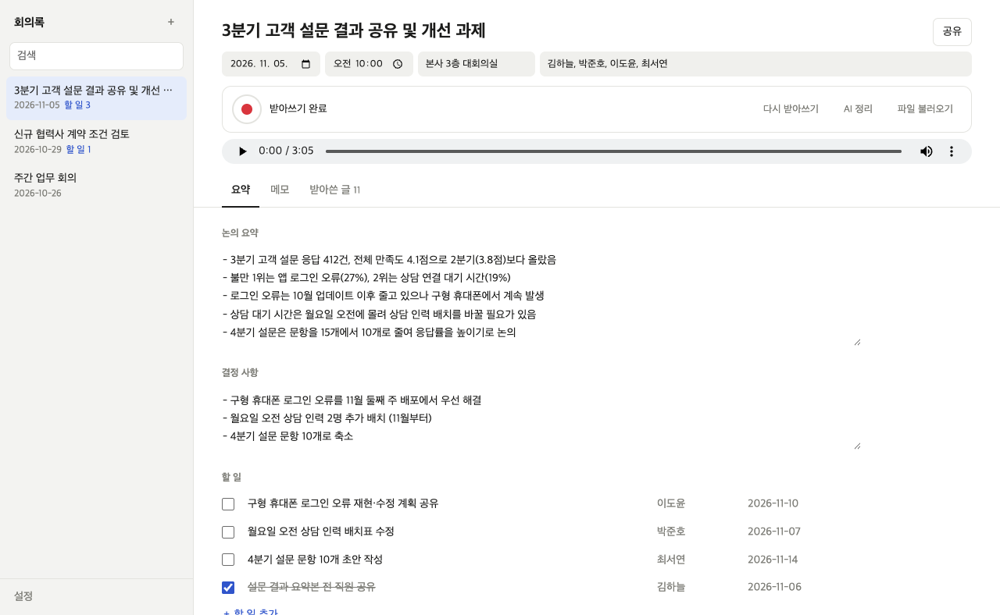
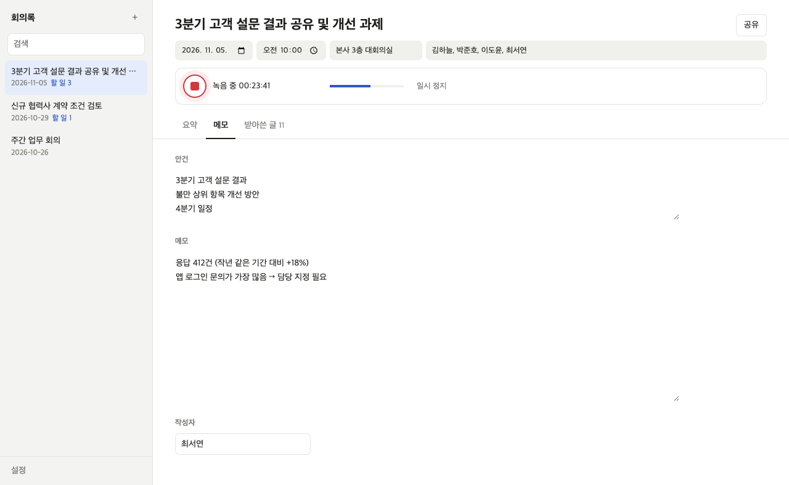
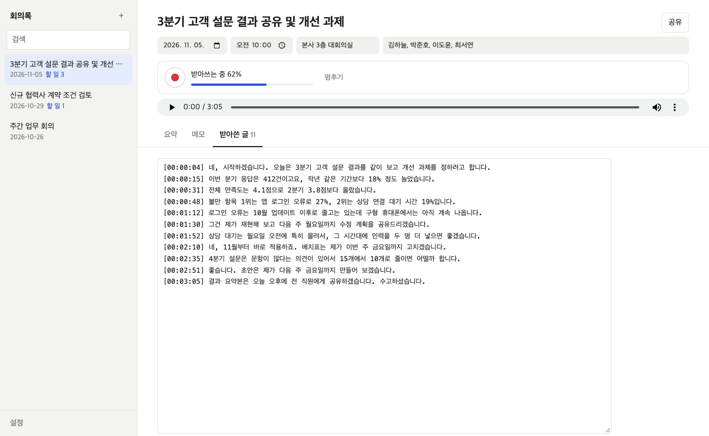
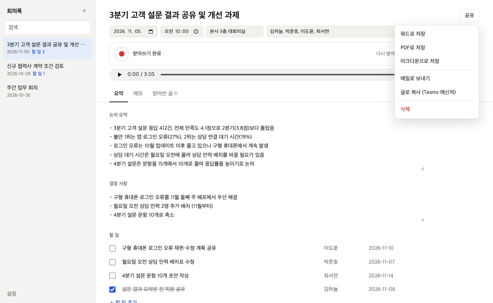
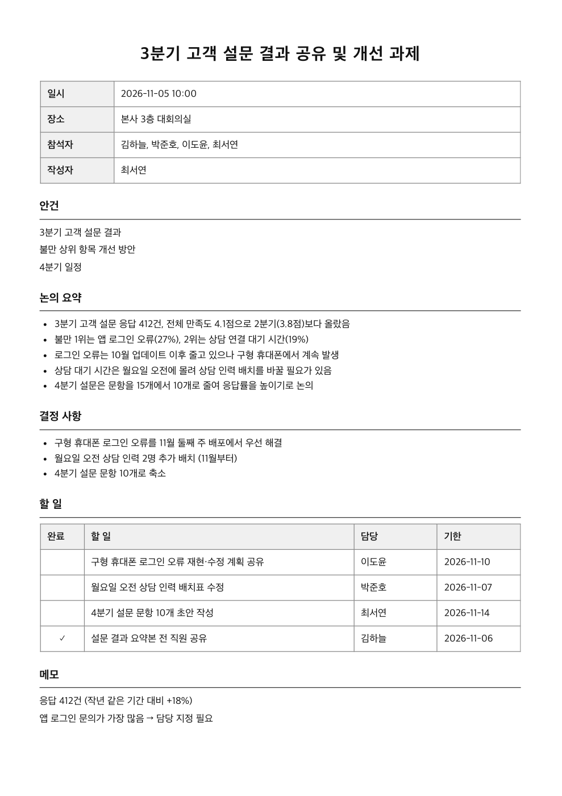
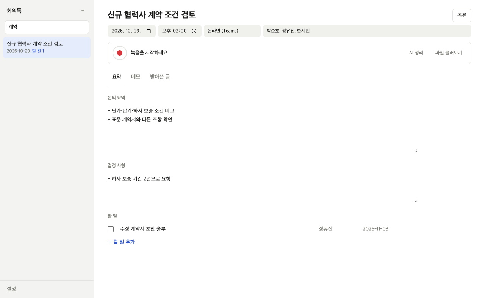
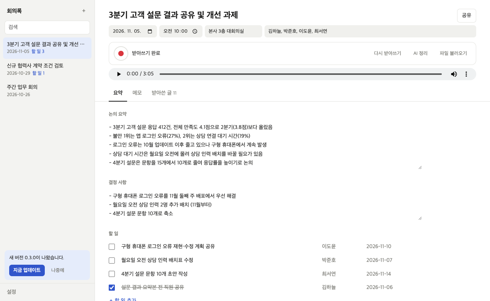
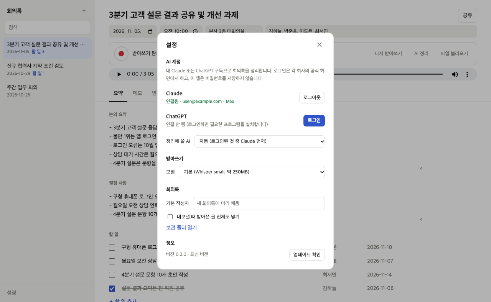
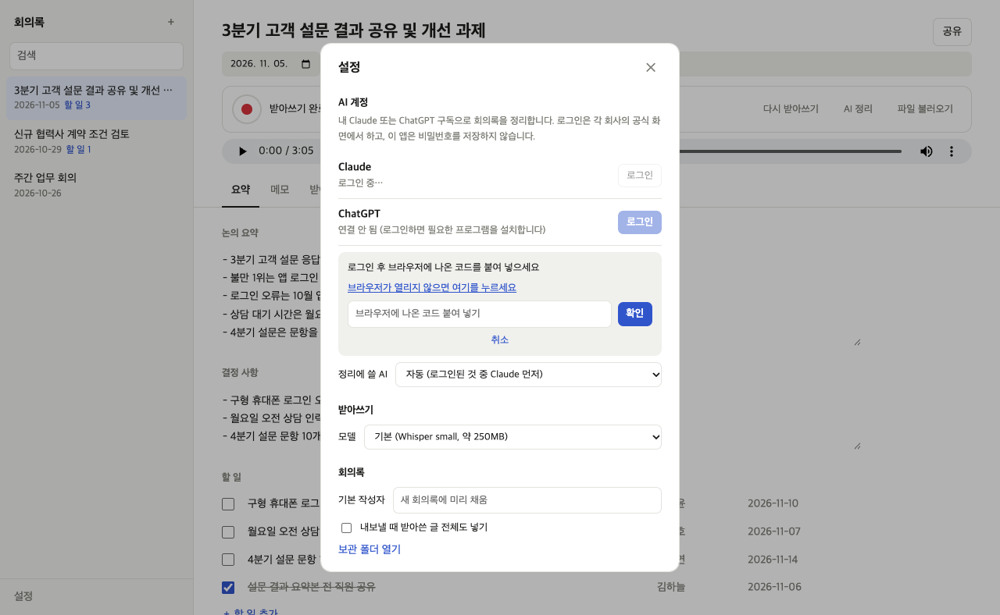

# 회의록 (MyMeetingNotes)

**회의를 녹음하면 이 PC 안에서 받아쓰고, 내 Claude·ChatGPT 구독으로 요약·결정 사항·할 일까지 정리해 주는 Windows 앱입니다.**

녹음과 받아쓰기는 **PC 안에서만** 처리합니다. 녹음 파일은 PC 밖으로 나가지 않고, AI 정리를 누를 때만 받아쓴 글이 내가 고른 AI로 갑니다.

| | |
|---|---|
| 🎙 **녹음** | 버튼 하나로 녹음·일시 정지. 5초마다 저장해 앱이 꺼져도 녹음이 남음. Teams 녹화 파일도 불러오기 |
| ✍️ **받아쓰기** | 녹음을 멈추면 바로 받아쓰기 시작. 문장마다 `[00:01:30]` 시각, 인터넷 없이 PC 안에서 |
| ✨ **AI 정리** | 내 구독 AI가 논의 요약·결정 사항·할 일(담당·기한)을 채움. API 키·별도 요금 없음 |
| 🗂 **보관·찾기** | 회의록이 날짜순으로 쌓이고, 제목·참석자·내용 어디든 검색. 남은 할 일 수 표시 |
| 📤 **공유** | 워드·PDF·마크다운으로 저장, 메일로 보내기, Teams·메신저에 붙여 넣을 글로 복사 |
| 🔄 **새 버전** | 새 버전이 나오면 알려 주고, **지금 업데이트** 한 번으로 바꿈 |

**바로 가기**: [받기](#받기-windows-1011-64비트) · [기능 소개](#기능-소개) · [설정 사용법](#설정-사용법) · [새 버전·지우기](#새-버전으로-바꾸기--지우기) · [개인 정보](#개인-정보) · [개발 안내](docs/개발.md)

> 아래 화면은 모두 가상의 회의록과 예시 계정으로 찍었습니다.

---

## 받기 (Windows 10/11 64비트)

1. [**Releases**](https://github.com/JinyoungPark/MyMeetingNotes/releases/latest)에서 `MeetingNotes-<버전>-windows-portable.zip`(약 190MB)을 받습니다.
2. 원하는 곳(예: `D:\Apps\MeetingNotes`)에 **압축을 모두 풉니다**. 설치는 필요 없습니다.
3. 폴더 안의 `MeetingNotes.exe`를 실행합니다. “Windows의 PC 보호” 창이 뜨면 **추가 정보 → 실행**.
4. 처음 켰을 때 AI 계정이 연결돼 있지 않으면 설정 창이 열립니다 → **AI 계정**에서 Claude 또는 ChatGPT로 로그인하면 준비 끝.

- **AI 정리를 쓰려면**: Claude(Pro·Max) 또는 ChatGPT(Plus 이상) 구독 계정. API 키는 필요 없습니다. AI 없이도 녹음·받아쓰기·보관·내보내기는 모두 됩니다.
- **필요한 것**: 마이크, 디스크 여유 1GB 이상 (받아쓰기 모델 약 250MB를 처음 한 번 받음).
- **새 버전 알림 받기**: 앱 왼쪽 아래에 저절로 뜹니다. 메일로도 받으려면 GitHub에 로그인한 뒤 이 저장소 오른쪽 위 **Watch → Custom → Releases**를 체크하세요.

---

## 기능 소개

### 1. 한 장짜리 회의록 — 정보 · 녹음 · 요약이 한 화면에

왼쪽은 회의록 목록, 오른쪽은 지금 회의록입니다. 맨 위에 제목과 날짜·시간·장소·참석자, 그 아래 녹음 줄, 그리고 **요약 · 메모 · 받아쓴 글** 탭이 있습니다.

- 왼쪽 위 **＋**(또는 `Ctrl+N`)로 새 회의록. 날짜·시간은 지금으로 채워집니다
- 고친 내용은 잠시 뒤 **저절로 저장**됩니다 (저장 버튼 없음)
- 목록에 **남은 할 일 수**가 보여서, 마무리 안 된 회의를 바로 알 수 있습니다

### 2. 녹음 — 빨간 버튼 하나

빨간 버튼을 누르면 녹음이 시작되고, 녹음 시간과 소리 크기 막대가 나옵니다. 녹음하는 동안 **메모** 탭에 안건·메모를 적어 두면 AI 정리에 함께 쓰입니다.

- **일시 정지 / 이어서 녹음**으로 쉬는 시간은 빼고 녹음
- 5초마다 파일에 저장해서, 앱이 갑자기 꺼져도 그때까지 녹음은 남습니다
- 이미 녹음한 파일(Teams 녹화, 휴대폰 녹음 등)은 **파일 불러오기** — m4a·mp3·wav·mp4 등

### 3. 받아쓰기 — 녹음을 멈추면 바로, PC 안에서

녹음을 멈추면 **받아쓰기가 저절로 시작**됩니다. 문장마다 녹음 시각이 붙어서, 재생기로 그 부분을 다시 들어 볼 수 있습니다.

- OpenAI의 음성 인식 모델 **Whisper**를 이 PC에서 돌립니다. 모델은 처음 한 번 받고, 그 뒤로는 **인터넷 없이** 받아씁니다
- 걸리는 시간은 녹음 길이·모델·PC 성능에 따라 다릅니다 (긴 회의는 수십 분). 진행률이 보이고, 받아쓰는 동안 **멈추기** 가능
- 받아쓴 글은 직접 고칠 수 있습니다. 잘못 들은 이름·숫자는 고친 뒤 AI 정리를 다시 누르세요

### 4. AI 정리 — 요약 · 결정 사항 · 할 일

받아쓰기가 끝나면 (AI 계정이 연결돼 있으면) **AI 정리가 이어서** 돕니다. 내 구독 AI가 받아쓴 글과 메모를 읽고 **논의 요약 · 결정 사항 · 할 일(담당·기한)**을 채웁니다. 제목이 비어 있으면 제목도 붙입니다.

- 음성 인식 오타는 문맥에 맞게 바로잡되, 없는 내용은 지어내지 않도록 지시합니다
- 결과는 모두 고칠 수 있고, 할 일은 체크로 완료 표시
- 다시 정리해도 **완료 표시한 할 일은 남깁니다**
- AI에게는 파일 읽기·명령 실행 같은 도구를 하나도 주지 않습니다 (받아쓴 글에 이상한 지시가 섞여 있어도 따르지 않게)

### 5. 공유 — 워드 · PDF · 메일 · 메신저

오른쪽 위 **공유**에서 고릅니다.

| | |
|---|---|
| **워드로 저장** | 개요 표(일시·장소·참석자·작성자) → 안건 → 논의 요약 → 결정 사항 → 할 일 표 → 메모 순서의 `.docx` |
| **PDF로 저장** | 같은 양식의 A4 PDF (아래 그림) |
| **마크다운으로 저장** | 노션·위키에 붙이기 좋은 `.md` |
| **메일로 보내기** | 기본 메일 프로그램에 제목·본문이 채워진 새 메일. 보내기는 직접 누릅니다 (길면 클립보드에 복사) |
| **글로 복사** | Teams·메신저에 바로 붙여 넣을 수 있는 글 |

- 설정에서 **내보낼 때 받아쓴 글 전체도 넣기**를 켜면 맨 뒤에 받아쓴 글이 붙습니다
- 파일 이름은 `2026-11-05 3분기 고객 설문 결과 공유 및 개선 과제.docx`처럼 날짜 + 제목

### 6. 찾기

왼쪽 위 검색 칸에 적으면 **제목 · 참석자 · 장소 · 안건 · 메모 · 받아쓴 글 · 요약 · 할 일** 어디에 있든 찾습니다. 여러 단어는 모두 들어 있는 회의록만 보여 줍니다.

### 7. 새 버전 알림 · 자동 업데이트

새 버전이 나오면 왼쪽 아래에 알림이 뜹니다.

1. **지금 업데이트**: 새 버전을 받아 풀어 둡니다 (진행률 표시). 그동안 앱은 그대로 쓸 수 있습니다.
2. **다시 시작해 업데이트**: 몇 초 안에 새 버전으로 다시 열립니다. 회의록·녹음·설정은 그대로입니다.
3. 백신·권한 때문에 막히면 **이전 버전으로 되돌린 뒤** 안내가 뜹니다. 그때는 [Releases](https://github.com/JinyoungPark/MyMeetingNotes/releases/latest)에서 새 zip을 직접 받아 압축을 풀고 실행하세요.

- **나중에**를 누르면 그 버전은 다시 알리지 않습니다 (설정 → 정보 → **업데이트 확인**으로 언제든 확인)
- 앱 폴더가 `Program Files`처럼 쓸 수 없는 곳이면 자동 업데이트 대신 받기 페이지를 엽니다

---

## 설정 사용법

왼쪽 맨 아래 **설정**을 누릅니다. 바꾸면 **바로 저장**됩니다. (AI 계정이 연결돼 있지 않으면 설정 옆에 주황 점이 보입니다.)

### AI 계정

1. **Claude** (Pro·Max): **로그인** → 앱이 공식 Claude 프로그램(Claude Code)을 뒤에서 설치하고 브라우저에 Claude 로그인 화면을 띄웁니다 → 승인 뒤 브라우저에 나온 **코드를 앱 입력칸에 붙여 넣고 확인**하면 **연결됨**.
2. **ChatGPT** (Plus 이상, 회사 Business 계정도): **로그인** → 앱이 공식 ChatGPT 프로그램(Codex)을 받고 브라우저에 OpenAI 로그인 화면을 띄웁니다 → 승인하면 끝 (코드 입력 없음).

   

   - 브라우저가 열리지 않으면 **브라우저가 열리지 않으면 여기를 누르세요**
   - 이미 이 PC에 Claude Code·Codex가 설치·로그인돼 있으면 바로 **연결됨**으로 보입니다
   - **로그아웃**은 공식 프로그램의 로그아웃입니다. 같은 로그인을 쓰는 이 PC의 Claude Code·Codex도 함께 로그아웃됩니다
   - 회사망에서 설치가 안 되면 claude.ai·github.com 접속이 막혀 있는지 확인하세요
3. **정리에 쓸 AI**: **자동**(로그인된 것 중 Claude 먼저) · Claude · ChatGPT.

### 받아쓰기

| 모델 | 처음 받는 크기 | 특징 |
|---|---|---|
| 빠름 (Whisper base) | 약 80MB | 가장 빠르지만 한국어 정확도가 낮음 |
| **기본** (Whisper small) | 약 250MB | 속도와 정확도의 균형 — 대부분 이것으로 충분 |
| 정확 (Whisper large-v3 turbo) | 약 1GB | 이름·숫자가 중요한 회의에. 메모리 8GB 이상 권장, 더 느림 |

회사망에서 huggingface.co 접속이 막혀 있으면 모델을 받지 못합니다.

### 회의록

- **기본 작성자**: 새 회의록의 작성자 칸에 미리 채웁니다
- **내보낼 때 받아쓴 글 전체도 넣기**: 워드·PDF·메일 끝에 받아쓴 글을 붙입니다
- **보관 폴더 열기**: 회의록이 저장된 폴더를 엽니다 (회의 하나 = 폴더 하나, `meeting.json` + 녹음 파일)

### 정보

버전과 새 버전 여부. **업데이트 확인**으로 바로 확인합니다.

---

## 새 버전으로 바꾸기 · 지우기

- **새 버전**: 왼쪽 아래 알림의 **지금 업데이트** → **다시 시작해 업데이트**. 직접 바꾸려면 앱을 닫고 새 zip을 같은 폴더에 덮어 풉니다.
- **백업**: `%APPDATA%\MeetingNotes\meetings` 폴더를 통째로 복사해 두면 됩니다.
- **완전히 지우기**: 앱 폴더와 `%APPDATA%\MeetingNotes`를 지웁니다. 회의록·녹음·받아쓰기 모델이 모두 지워집니다.

## 개인 정보

- 회의록·녹음·설정은 이 PC의 `%APPDATA%\MeetingNotes`에만 저장됩니다.
- **녹음 파일은 PC 밖으로 나가지 않습니다.** 받아쓰기는 PC 안에서 합니다.
- **AI 정리**를 누를 때만 회의 정보·메모·받아쓴 글이 고른 AI 서비스(Anthropic 또는 OpenAI)로 갑니다. 회사 회의 내용은 보안 기준을 먼저 확인하세요.
- 로그인은 각 회사의 공식 프로그램과 화면에서 하며, 이 앱은 비밀번호·토큰을 읽거나 저장하지 않습니다.
- 사용 통계·원격 수집은 없습니다. 인터넷은 받아쓰기 모델 받기(Hugging Face), AI 로그인·정리(Anthropic·OpenAI), 새 버전 확인(GitHub)에만 씁니다.
